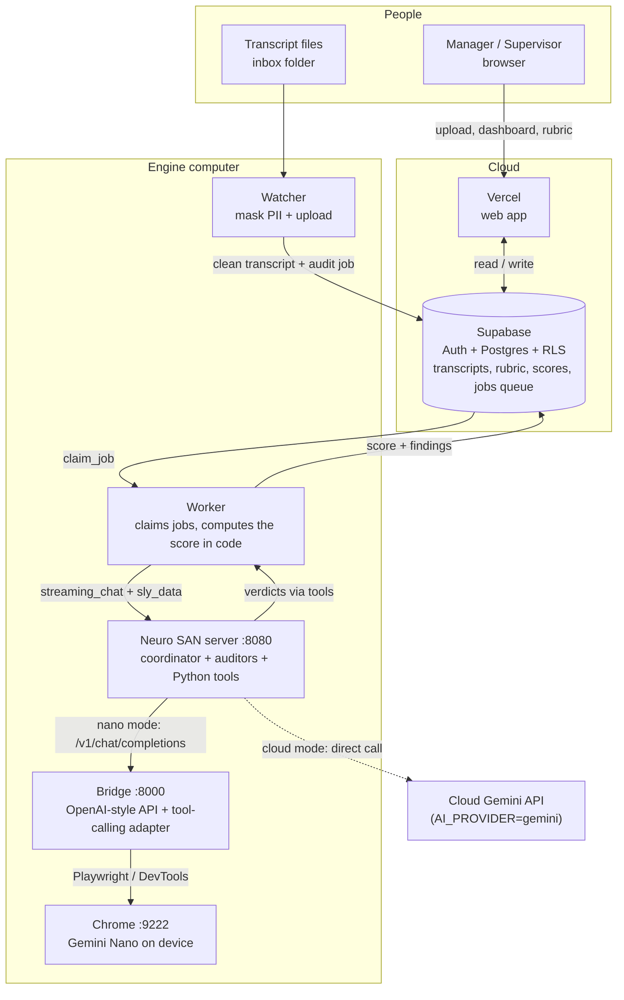

# Bridge explained

How the local engine works, piece by piece: the bridge, the watcher, the worker, the Neuro SAN server and the tools
built around them. Written so you can answer "what does it consist of, and which packages does it use?" with
confidence.

---

## 1. The 30-second answer

> The web app (Vercel) only stores and shows data in Supabase. The **audit engine runs on a laptop**: a
> **file watcher** ingests transcripts, a **worker** claims queued jobs from Supabase and asks a **Neuro SAN agent
> network** to judge them, and the agents' "brain" is **Gemini Nano inside Chrome**, reached through a small
> **FastAPI bridge** that speaks the OpenAI chat protocol. Nothing leaves the laptop except the scores written back
> to Supabase.

```
 Vercel web app ──► Supabase (Postgres + RLS + Auth) ◄── jobs queue ──┐
                                                                      │ claim_job()
 inbox/*.json ──► WATCHER ──► (mask PII, upload) ──► Supabase         │
                                                                      │
                                         WORKER ◄─────────────────────┘
                                           │  HTTP  /api/v1/<network>/streaming_chat
                                           ▼
                                 NEURO SAN SERVER :8080  (agent networks, coded tools)
                                           │  OpenAI-style  /v1/chat/completions
                                           ▼
                                      BRIDGE :8000  (FastAPI)
                                           │  Playwright over Chrome DevTools Protocol :9222
                                           ▼
                                 CHROME  →  window.LanguageModel  =  Gemini Nano (on device)
```

The same flow as a diagram (rendered in the documentation page; paste it into mermaid.live to edit it):



Ports: **9222** Chrome debug, **8000** bridge, **8080** Neuro SAN server, **4173** Studio UI (dev only).

---

## 2. The bridge (`bridge.py`)

**Why it exists.** Neuro SAN talks to its language model like it talks to OpenAI (`/v1/chat/completions`, with
tool calling). Gemini Nano is not a server: it is a JavaScript API (`window.LanguageModel`, the Chrome *Prompt API*)
that only exists inside a Chrome page. The bridge is the adapter that makes Chrome look like an OpenAI endpoint.

**How it works**

1. **Start-up.** FastAPI starts; Playwright connects to the already-running Chrome with
   `connect_over_cdp("http://localhost:9222")`. Chrome was launched with `--remote-debugging-port=9222` and the
   flags that switch Gemini Nano on (`PromptAPIForGeminiNano`, `OptimizationGuideOnDeviceModel`).
2. **A secure origin.** The Prompt API only works on a real origin, not `about:blank`, so the bridge serves a tiny
   page at `http://127.0.0.1:8000/` and keeps Chrome's tab on it.
3. **Warm-up.** The first model call after Chrome starts is slow (loading the model: up to ~2–3 minutes). The bridge
   sends one throw-away prompt in the background; `GET /health` returns `model_ready: true` when done. The launcher
   waits for that before starting the worker.
4. **Each request** to `POST /v1/chat/completions` becomes a JavaScript call run in the page with
   `page.evaluate(CHAT_JS, args)`. Values travel as arguments, never pasted into the script text (no injection).
5. **Deterministic answers.** It creates the session with `temperature: 0, topK: 1`, so the same transcript gives
   the same score. If this Chrome build rejects the options it falls back (default sampling → legacy
   `systemPrompt`) and logs that the run is *not deterministic*.
6. **Structured output.** When a JSON schema is supplied, `session.prompt(..., { responseConstraint: schema })` makes
   Chrome emit only JSON that matches. It has its own timeout (150 s) and falls back to a plain prompt on a fresh
   session if it hangs. A hard limit of 300 s per request returns HTTP 504 instead of blocking forever.
7. **Other endpoints:** `/api/summarize` (Chrome Summarizer API), `/health`, `/`.

**Packages:** `fastapi`, `uvicorn`, `pydantic`, `playwright` (async API, CDP only: it does not download its own
browser).

**One request at a time.** Chrome's model answers one request at a time, but Neuro SAN's coordinator calls several
auditors in parallel. The bridge therefore puts requests in a queue (`model_lock`): each waits its turn and its timeout
clock only runs while the model works on it. The bridge prints `The model is busy; this request waits its turn (N
waiting)` when that happens: it is normal, not an error. The summarizer shares the same queue.

**Cloud mode.** With `AI_PROVIDER=gemini` the bridge and Chrome are not used at all: the agents call cloud Gemini
directly and `qa_engine/gemini_client.py` makes the call summary (see `Agent building guide.md`, section 6).

### 2.1 The tool-calling adapter (`bridge_tools.py`, class `ToolCallAdapter`)

Gemini Nano has **no native function calling**, but Neuro SAN's agents work by calling each other as tools. The
adapter translates:

| Step | What it does |
|---|---|
| `tool_specs` / `_describe_tools` | Turns the OpenAI `tools` list into a plain-text menu for the model |
| `response_schema` | Builds a JSON schema so the model must answer either `{"tool_calls":[…]}` or a final answer |
| `build_user_prompt` | Folds the conversation, previous tool results and a "how to reply" block into one prompt |
| `required_tools` / `called_tools` / `_status` | Reads the agent's instructions to see which tools **must** be called, and tells the model which are still missing |
| `parse_reply` | Validates the reply; **rejects** unknown tools, missing required arguments, and **repeated identical calls** |
| `tool_turn` (in bridge.py) | If a reply is rejected it retries (up to 3 attempts), feeding the reason back to the model |
| Finishing | When all work is done but the model gives an empty final reply, the sentence named in the agent's instructions ("reply with: Recorded.") is used instead of failing |

The result is converted back into a normal OpenAI `tool_calls` message, so Neuro SAN believes it is talking to
a function-calling model. This is what makes the **real delegation between agents** work (front man → sub-agents →
coded tools) on a model that cannot do it by itself.

---

## 3. The watcher (`watcher.py` + `qa_engine/ingest_handler.py` + `preprocessor.py`)

**Job:** turn files dropped in `inbox/` into rows in Supabase, ready to audit.

1. **`watchdog`** `Observer` watches `./inbox` (relative to the working directory) for new files.
2. **`DeterministicSanitizer`** (`preprocessor.py`) masks PII with regular expressions *before anything leaves the
   laptop*: card numbers, SSN, e-mail, phone → `[REDACTED_…]`. It also slices the transcript (opening, closing, full).
   Known gaps (documented): CVV, PIN, expiry date, address, international phone, IBAN.
3. **`IngestHandler`** signs in to Supabase **as a real tenant user** (`INGEST_EMAIL` / `INGEST_PASSWORD`) with the
   `supabase` client and the public anon key. Because it is a normal user, **Row-Level Security applies**: it can
   only write into its own tenant. It inserts the transcript and a `jobs` row of kind `audit`.
4. The file is moved to `processed/` (or `failed/` with the error).

**Packages:** `watchdog`, `supabase` (and `postgrest`), `python-dotenv`.

---

## 4. The worker (`worker.py` + `qa_engine/`)

**Job:** take queued jobs and have the agents do them. It is the only piece with database-level access.

| Class | Role |
|---|---|
| `Settings` | Reads environment variables (`.env`), fails loudly if a required one is missing |
| `RunnerFactory` / `HandlerFactory` | Build the audit runner and the other job handlers from settings |
| `JobWorker` | Loop: `claim_job()` → run → save → repeat; sleeps when idle; **3 attempts** then `failed` |
| `TenantDatabase` | `psycopg` connection pinned to ONE tenant: `select set_config('app.current_tenant', …, true)` so RLS applies to every statement |
| `AuditRunner` | Builds **one task per rubric check**, calls Neuro SAN, collects verdicts; re-asks only the checks that are missing (up to 3 rounds) |
| `NeuroSanClient` | `POST /api/v1/<network>/streaming_chat` with `user_message` + `sly_data`; reads the streamed reply |
| `VerdictParser` | Strict parsing of each verdict; cleans empty reasons ("None", "N/A") |
| `ScoreCalculator` | The score is computed **in code**, never by the model |
| `LearnedExamples` | Adds reviewer-corrected examples to each check (the learning loop) |
| `FindingsBuilder` | Quotes and findings for the UI |
| `IdentityOrder` | Counts, in code, whether the agent verified the caller (date of birth, PIN, security answer) BEFORE stating an account detail. It hands the auditor the line numbers as a fact and decides the identity check itself when the lines are found (a small model cannot compare line order reliably) |
| `CriticalGuard` | A critical fail must quote a line the agent really said. Without that quote it is marked unverified: the call is not zeroed, it gets a `NEEDS_REVIEW` flag and cannot pass, and a person decides |
| Handlers | `report` (`PerformanceStats` computed in code), `research` (rubric proposals), `chat` (assistant) |

**Security design.** The only cross-tenant statement is `public.claim_job(kinds[])`. Everything after it runs in a
transaction scoped to that job's tenant. The worker connects as the restricted Postgres role **`qa_worker`**
(`DATABASE_URL`), not as an administrator.

**Job kinds:** `audit`, `report`, `research`, `chat`.

**Packages:** `psycopg[binary]`, `requests`, `python-dotenv`.

---

## 5. Neuro SAN (the agent framework)

Required by the project and used for real. Agent networks are declared in **HOCON** files in `registries/`
(listed in `manifest.hocon`); Python tools live in `coded_tools/`.

| Network | Agents | Purpose |
|---|---|---|
| `qa_audit` | front man + one auditor per check | Judge a transcript |
| `qa_report` | analyst + `load_stats` tool | Performance reports (numbers come from code) |
| `qa_research` | researcher | Propose rubric improvements (need admin approval) |
| `qa_assistant` | assistant + data pack | Answer staff questions |
| `qa_platform` | router | Demo of one front door to all networks |

Key ideas to mention:

- **Front man** is an LLM agent that delegates to **sub-agents** by tool calling.
- **Coded tools** (`CodedTool.async_invoke(args, sly_data)`) do the deterministic work: `load_check` reads the check
  to apply, `record_verdict` stores the verdict, `load_stats` reads figures.
- **`sly_data`** is a private channel: transcript, tenant data and verdicts travel there and are **never shown to
  the model**.
- A tool must have at least one argument or Neuro SAN silently drops it (we hit this with `load_stats`).
- Server run with `python -m neuro_san_studio run --server-only --server-http-port 8080`; the model address is
  the bridge, with `OPENAI_API_KEY=local-nano` (a dummy value).

**Packages:** `neuro-san==0.7.7`, `nsflow==0.7.4` (Studio UI), `langchain-*`.

---

### Watching the agents talk (the AGENTS log)

The engine can write the conversation of the agents to `C:\QAEngine\data\logs\agents.log`; the **Show logs** shortcut opens
it in its own window. Neuro SAN streams every message of a run when asked for the "maximal" chat filter, and
`qa_engine/agent_trace.py` turns each one into a line:

```
qa_audit         is asked:  Checks to run: compliance, closing
qa_audit         ->  check_auditor    check_key="compliance"
check_auditor    ->  load_check       check_key="compliance"
load_check       <-  check_auditor    (1,240 characters, not shown)
check_auditor    ->  record_verdict   check_key="compliance", passed=False, reason="..."
record_verdict   <-  check_auditor    Recorded the verdict for compliance.
qa_audit         says:  All checks completed.
```

`->` is a call, `<-` is what comes back, `#2` marks the second parallel copy of the same agent. The task text handed to an
auditor contains part of the call, so only its size is shown. The file is switched on by the `QA_AGENT_TRACE_FILE`
environment variable (the launcher sets it), it never interferes with an audit, and it is emptied at start when it grows
beyond 2 MB.

## 6. Who talks to whom (one audit, end to end)

1. A manager uploads a transcript in the web app → stored in Supabase + a `jobs` row (`audit`, `queued`).
   (Or a file lands in `inbox/` → watcher does the same after masking.)
2. The **worker** calls `claim_job()`, receives the job, scopes the connection to the tenant, loads the transcript
   and the tenant's rubric.
3. It sends Neuro SAN one task per check, with the data in `sly_data`.
4. The front man calls the auditor sub-agents; each one calls `load_check`, reasons, and calls `record_verdict`.
   Every model turn is an HTTP request to the **bridge**, which runs it in Gemini Nano through Chrome.
5. The worker reads the verdicts from `sly_data`, re-asks any missing check, computes the score in code, and writes
   the result to Supabase.
6. The dashboard shows it; reviewers can correct verdicts, and those corrections come back as learned examples.

An audit takes roughly 2.5–3 minutes on a laptop.

---

## 7. Tools we built (and why)

| Tool | File | Why |
|---|---|---|
| Bridge | `bridge.py` | Chrome Gemini Nano as an OpenAI-compatible endpoint |
| Tool-calling adapter | `bridge_tools.py` | Function calling on a model without it |
| Sanitizer | `preprocessor.py` | PII masking before upload |
| Watcher / worker | `watcher.py`, `worker.py` | Ingestion and job processing |
| Tool-calling check | `check_tool_calling.py` | Proves the model can drive Neuro SAN tools |
| Accuracy evaluation | `evaluate_samples.py`, `evaluation/` | Scores sample transcripts against a gold answer key |
| Deploy script | `deploy-vercel.ps1` | Deploys the web app without Node or GitHub |
| Launcher / installer | `packaging/` | One-click install and start on a manager's laptop |
| Tests | `tests/` | Unit tests for the engine and the bridge, UI smoke test with Playwright |

---

## 8. Package list (what to say if asked)

| Area | Packages |
|---|---|
| Agent framework | neuro-san 0.7.7, nsflow 0.7.4, langchain-* |
| Bridge | fastapi, uvicorn, pydantic, playwright |
| Database | psycopg[binary] (worker, direct Postgres), supabase / postgrest (watcher) |
| Files | watchdog |
| Config | python-dotenv |
| HTTP | requests, httpx (web app) |
| Web app | FastAPI on Vercel, plain HTML/JS, supabase-js 2.45.4 |
| Runtime | Python 3.12+, Google Chrome with Gemini Nano |

---

## 9. Likely questions, short answers

- **Why a bridge and not an API?** Nano runs only inside Chrome; the bridge makes it look like OpenAI so Neuro SAN
  needs no changes.
- **Is the audit private?** The model runs on the laptop. Only masked text and results reach Supabase.
- **Why is it deterministic?** Temperature 0, topK 1, and the score is computed in code, not by the model.
- **Can the model decide the score?** No. It only gives per-check verdicts; code calculates the score.
- **How is tenant isolation kept?** Postgres RLS + `app.current_tenant` set per transaction + restricted `qa_worker`.
- **What if the model is slow or Chrome hangs?** Timeouts (150 s / 300 s), retries, jobs requeued up to 3 times.
- **What if a laptop goes off?** Another manager's engine keeps claiming jobs from the same queue. (Check before
  the demo that `claim_job` in your database locks the row it hands out, e.g. `for update skip locked`, so two
  engines never take the same job: that function was created in the original Supabase setup, not in the files in
  this folder.)
