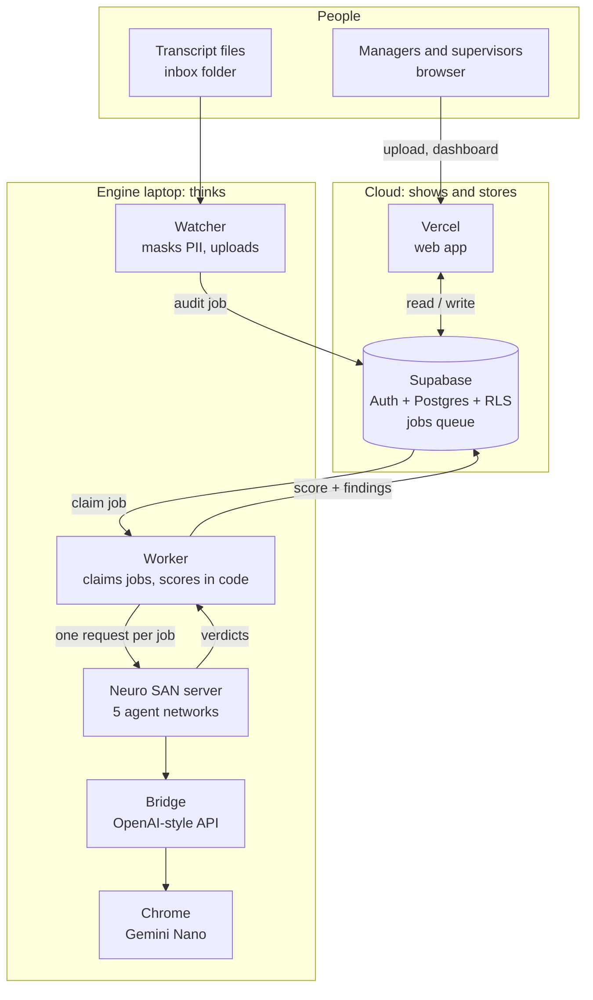
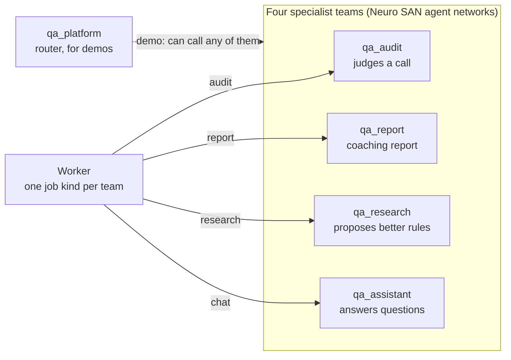

# Hackathon pitch (10 minutes)

## Presenter: before you start (10 minutes earlier)

<ul>
<li>Start the engine (<b>QA Engine &ndash; Start</b>) and wait for <i>The engine is running</i>. Run <b>QA Engine &ndash; Status</b>: everything green, "Gemini Nano model is loaded".</li>
<li>Open <b>QA Engine &ndash; Show logs</b> and arrange the four windows on a second screen (or minimise them). Make the font bigger (Ctrl + mouse wheel).</li>
<li>Website open and logged in as admin. Keep these ready: <b>Anna</b> and <b>Tom&aacute;s</b> already audited with the current engine (your safety net), and the file <code>AGT-MOCK-ANNA.txt</code> to upload live.</li>
<li><b>Start the live audit at the beginning of Slide 3</b> (upload Anna, press Save &amp; queue). With Nano it takes about 3 to 5 minutes, so it finishes while you speak.</li>
<li>This page in <b>Presentation mode</b> (button at the top of this tab). Keys: <b>&rarr;</b> next, <b>&larr;</b> back, <b>N</b> shows or hides your notes, <b>Esc</b> leaves.</li>
<li>Do not restart anything once you start. Close chat apps and notifications.</li>
</ul>

<b>10</b>minutes, 8 slides

<b>5</b>agent teams on Neuro SAN

<b>0</b>patches to the framework

<b>1</b>live audit, start it at Slide 3

## Slide 1 &middot; Every call audited. Privately. By agents.

0:00 &ndash; 0:50

<svg viewBox="0 0 960 150" role="img" aria-label="Pipeline: calls, masking, agents, score in code, human review">
<defs><marker id="ar" viewBox="0 0 10 10" refX="9" refY="5" markerWidth="7" markerHeight="7" orient="auto"><path d="M0 0 L10 5 L0 10 z" class="glow"/></marker></defs>
<g class="soft"><rect x="10" y="35" width="150" height="80" rx="16"/><rect x="200" y="35" width="150" height="80" rx="16"/><rect x="390" y="35" width="180" height="80" rx="16"/><rect x="610" y="35" width="150" height="80" rx="16"/><rect x="800" y="35" width="150" height="80" rx="16"/></g>
<g class="stroke"><path d="M160 75 H196" marker-end="url(#ar)"/><path d="M350 75 H386" marker-end="url(#ar)"/><path d="M570 75 H606" marker-end="url(#ar)"/><path d="M760 75 H796" marker-end="url(#ar)"/></g>
<g text-anchor="middle" font-size="17" font-weight="700"><text x="85" y="70">Every call</text><text x="275" y="70">Mask PII</text><text x="480" y="70">Agent teams</text><text x="685" y="70">Score by code</text><text x="875" y="70">Human review</text></g>
<g text-anchor="middle" font-size="13" class="muted"><text x="85" y="92">voice, chat, email</text><text x="275" y="92">before it leaves</text><text x="480" y="92">Neuro SAN + Nano</text><text x="685" y="92">weights, critical rule</text><text x="875" y="92">and it learns</text></g>
</svg>

The whole idea in one line

Good morning. Contact centers review only a small sample of their calls, and they do it by hand. We built a platform that audits <b>every</b> call against the company's own rules, explains every verdict, and keeps the customer data on the company's own laptop.

It is five teams of AI agents built on <b>Neuro SAN</b>, running on an AI model that already ships inside Chrome. In ten minutes I will show you how it is put together, why we made each choice, and then you will watch the agents audit a real call.

## Slide 2 &middot; What we had to work with, and how open source helped

0:50 &ndash; 2:00

1<h4>No Node.js, no GitHub</h4>
So the website is deployed with a PowerShell script that calls Vercel's API.

2<h4>No database we can install</h4>
So we use Supabase: managed Postgres, login and row-level security.

3<h4>Locked corporate laptops</h4>
So the engine installs for one user, with no admin rights.

4<h4>No cloud AI key (yet)</h4>
So the AI is Gemini Nano, inside Chrome, on the laptop.

5<h4>Customer data is private</h4>
So the AI step never leaves the laptop, and the text is masked first.

6<h4>Neuro SAN is required</h4>
So the audit is done by real cooperating agents, not by one big prompt.

<h4>What open source let us do</h4><ul><li>Read how Neuro SAN talks to a model, and plug in <b>any OpenAI-compatible endpoint</b></li><li>Write <b>coded tools</b> in plain Python</li><li>Move private data through <code>sly_data</code>, outside the prompts</li><li>Validate networks with the framework's own command</li></ul>

<h4>What we did not have to do</h4><ul><li>Fork or patch the framework: everything is <b>configuration + tools + one adapter</b></li><li>Rewrite anything to switch models: the model is one block, <code>llm_config</code></li><li>Depend on a vendor: the same agents can use Gemini in the cloud tomorrow</li></ul>

We did not start in ideal conditions: no Node, no GitHub, no database we could install, locked laptops, no cloud AI key, and a strict privacy requirement.

Neuro SAN being <b>open source</b> is what made the plan possible. We could read how it talks to a model, and saw that any OpenAI-compatible endpoint can be plugged in through one block of configuration. So we built a small <b>bridge</b> that makes Chrome's on-device Gemini Nano look like such an endpoint. We did not touch the framework's code. And because the model is one block, going to a cloud model later is a settings change, not a rewrite.

## Slide 3 &middot; The big picture

2:00 &ndash; 3:30START THE LIVE AUDIT NOW

Three layers. In the <b>cloud</b>, a web app on Vercel and a Supabase database: people log in, upload calls and read results, and every company only sees its own rows, enforced by the database itself.

On the <b>laptop</b>, the engine: a watcher for files, a worker that takes jobs from a queue, the Neuro SAN server with our agent teams, and the bridge to Chrome's Gemini Nano.

Between them, a <b>jobs queue</b>. The website never talks to the engine: it writes a job, and the engine picks it up. If the laptop is off nothing is lost, the jobs wait. And because anyone can run an engine, managers can cover shifts.

Upload <code>AGT-MOCK-ANNA.txt</code> now (New audit, leave the agent name empty, Save &amp; queue). Say you did it: "I have just queued a real call; we will come back to it."

## Slide 4 &middot; Neuro SAN: five teams of agents

3:30 &ndash; 5:00

<b>5</b>agent networks

<b>8</b>AI agents

<b>7</b>coded tools (plain Python)

<b>1</b>private channel: sly_data

In Neuro SAN a team is an <b>agent network</b>, defined in a text file. We have five: audit, report, research, assistant, and a router I use to demo them together.

Take the audit team. A <b>coordinator</b> receives "check these rules" and delegates each rule to an <b>auditor</b> agent. Each auditor calls a coded tool to read its task, decides pass or fail, and calls another tool to record the verdict. The call itself never travels through a prompt: it moves in <b>sly_data</b>, Neuro SAN's private channel, so the model only handles short keys.

Nano cannot call tools by itself, so the bridge translates: Nano still chooses the tool and its arguments, and Neuro SAN still runs the tool. And the score is never the AI's job: plain Python applies the weights and the critical-fail rule.

"Do the networks call each other?" Not in production: the worker dispatches by job kind, and they connect through the database. Only the demo router calls them. See the Technical questions tab.

## Slide 5 &middot; Live: watch the agents work

5:00 &ndash; 7:15

<b>1. Worker</b><small>claims the job</small>

<b>2. Agents</b><small>coordinator &rarr; auditors &rarr; tools</small>

<b>3. Bridge</b><small>each turn runs in Nano</small>

<b>4. Code</b><small>order check, guard, score</small>

<b>5. Dashboard</b><small>result with reasons</small>

<ol>
<li><b>Show the four windows</b> (Show logs). "Worker, agents, bridge, Neuro SAN."</li>
<li><b>Worker window:</b> the line <code>Claimed audit job</code>. "The engine picked up the job I queued."</li>
<li><b>AGENTS window:</b> point at the arrows: <code>qa_audit -&gt; check_auditor</code>, <code>check_auditor -&gt; load_check</code>, <code>record_verdict</code>. "This is the agents talking to each other and to their tools."</li>
<li><b>Bridge window:</b> <code>Tool turn: calls ...</code> and "waits its turn". "Every turn runs in the on-device model, one at a time."</li>
<li><b>Dashboard, when it finishes:</b> Anna shows <b>0, Critical fail</b>. Open it: the Identity reason quotes <b>line 3</b> (details first) and <b>line 5</b> (verification after).</li>
<li><b>Tom&aacute;s</b> (already audited): the red <b>Needs review</b> pill. Reviews &rarr; Flagged by the AI &rarr; Review &amp; edit score. Fix Data Protection, save. Then Learning: "my correction is now learning data."</li>
</ol>

This is the call I queued a few minutes ago. The worker picked it up; here the coordinator hands one rule to each auditor, the auditors read their task and record a verdict, and every model turn goes through the bridge into Gemini Nano.

The call looks perfect: a warm opening, a ticket number, a polite goodbye. The breach is in the middle: the agent revealed the customer's charges <b>before</b> verifying who they were. The result is a <b>critical fail</b>, and the reason quotes the two lines, so anyone can check it.

When the model is unsure, we do not pretend. This one was flagged <b>Needs review</b>. A person decides, and the correction is saved as learning data.

<b>If the live audit is not finished yet:</b> open Anna's earlier result and say "this is the same call from a previous run". Do not wait in silence: go on to Slide 6 and come back.

## Slide 6 &middot; How we made a small model trustworthy

7:15 &ndash; 8:15

<b>Mask</b><small>cards, SSN, e-mail, phone</small>

<b>Facts by code</b><small>who verified first?</small>

<b>Agents propose</b><small>verdict + reason</small>

<b>Guard</b><small>critical fail needs a quote</small>

<b>Score by code</b><small>weights, critical rule</small>

<b>Human + learning</b><small>review, correct, learn</small>

<table>
<thead><tr><th>Call</th><th>What the small model said alone</th><th>With our guard rails</th></tr></thead>
<tbody>
<tr><td><b>Anna</b> verifies after revealing details</td><td>Pass, 100 (a dangerous miss)</td><td><b>Critical fail, 0</b>: code compares the line order and quotes both lines</td></tr>
<tr><td><b>Tom&aacute;s</b> switches language, drops the call</td><td>Critical fail, 0 (a false alarm)</td><td><b>Needs review</b>: an unproven critical fail never zeroes a call</td></tr>
<tr><td><b>Priya</b> card read back aloud</td><td>Critical fail</td><td>Still a critical fail: the quote proves it</td></tr>
</tbody>
</table>

An on-device model is private and free to run, but small models make mistakes. So we did not ask it to be perfect: we built <b>guard rails around it</b>. Code masks the personal data first. Code works out facts a small model cannot, like which line came first. The agents propose verdicts. A guard refuses to let a critical fail stand unless it quotes something the agent really said. And code, not AI, computes the score.

Here are three real calls. The same model, alone, gave Anna a pass. With the guard rails, Anna is a critical fail with the two lines quoted, and Tom&aacute;s, who was wrongly zeroed, is flagged for a human instead. Honest limit: we measured this on a small set of calls, and the next step is a larger test set.

## Slide 7 &middot; Run it like a product

8:15 &ndash; 9:00

1<h4>One-click install</h4>
A folder with an installer: it checks the package, asks for the secrets file, builds the environment.

2<h4>Shifts</h4>
Any manager can run an engine. Several can share the same queue.

3<h4>Safe updates</h4>
New version next to the old one, settings kept, rollback by editing one file.

4<h4>Secrets</h4>
Never in the package. Stored encrypted for the Windows user; Vercel holds the service key.

5<h4>Visible</h4>
Status screen, per-service logs, and the live agents window.

6<h4>Tested</h4>
About 260 automated checks, including the UI in a real browser.

It is not a demo script, it is installable. A manager copies one folder, double-clicks the installer, picks the secrets file we send privately, and the engine is running. Updates install beside the old version and keep the settings, and rolling back is changing one number. Secrets are never in the package. And we test it: about two hundred and sixty automated checks, including the website in a real browser.

## Slide 8 &middot; Cloud-ready, and what comes next

9:00 &ndash; 10:00

<h4>Today: on-device Gemini Nano</h4><ul><li>Private by design</li><li>No per-call cost</li><li>About 3 to 5 minutes per audit</li><li>Needs the guard rails</li></ul>

<h4>Next: cloud Gemini (one setting)</h4><ul><li><code>AI_PROVIDER=gemini</code> + the credential</li><li>Seconds, in parallel</li><li>Richer checks, a verifier agent</li><li>Needs data-protection approval</li></ul>

<ul class="timeline">
<li><b>Now:</b> five agent teams, review and learning loop, installer, live logs</li>
<li><b>When access is approved:</b> switch to Gemini (service account or login), re-run the test set</li>
<li><b>Then:</b> fallbacks between models, a verifier for critical fails, tracing with Phoenix or Langfuse</li>
<li><b>Then:</b> notification agent (e-mail alerts), skills for coaching, MCP integrations</li>
</ul>

So where are we? Everything you saw runs today, privately, on the hardware we have. And because Neuro SAN is open and the model is one block of configuration, the same agents can move to Gemini in the cloud with a setting, as soon as access is approved. After that: a second-opinion agent for critical fails, tracing, e-mail alerts, and the framework's skills and MCP integrations.

What we would like from you: approval for the cloud access, and a larger set of real calls to measure the accuracy. Thank you. Happy to take questions, and I can show any part of this live.

## Presenter: if something goes wrong

<table>
<thead><tr><th>Problem</th><th>What to do and say</th></tr></thead>
<tbody>
<tr><td>The live audit is slow</td><td>Keep talking, go to Slide 6, and come back. Or open the earlier result: "same call, previous run".</td></tr>
<tr><td>Nano gives a different answer</td><td>"That is exactly why the guard rails and the human review exist." Show the Needs review flow.</td></tr>
<tr><td>A window shows an error</td><td>Do not debug live. Say "the queue retries three times" and move on. Status shows what is red.</td></tr>
<tr><td>The website is down</td><td>The engine and logs still work. Show the Diagrams tab and walk through the flow.</td></tr>
<tr><td>Questions you cannot answer</td><td>"I will confirm and come back to you." Do not guess: the Technical questions tab has most answers.</td></tr>
</tbody>
</table>

## Presenter: timing cheat sheet

<table>
<thead><tr><th>Slide</th><th>Minutes</th><th>Cumulative</th><th>Must say</th></tr></thead>
<tbody>
<tr><td>1 Problem</td><td>0:50</td><td>0:50</td><td>Every call, private, agents</td></tr>
<tr><td>2 Constraints</td><td>1:10</td><td>2:00</td><td>Open source = adapt, no fork</td></tr>
<tr><td>3 Big picture</td><td>1:30</td><td>3:30</td><td>Cloud shows, laptop thinks, queue connects. <b>Start the audit</b></td></tr>
<tr><td>4 Neuro SAN</td><td>1:30</td><td>5:00</td><td>Coordinator &rarr; auditor &rarr; tools; sly_data; score is code</td></tr>
<tr><td>5 Live</td><td>2:15</td><td>7:15</td><td>Logs, agents talking, critical fail with quotes, Needs review</td></tr>
<tr><td>6 Trust</td><td>1:00</td><td>8:15</td><td>Guard rails around a small model</td></tr>
<tr><td>7 Product</td><td>0:45</td><td>9:00</td><td>Installer, shifts, updates, tests</td></tr>
<tr><td>8 Next</td><td>1:00</td><td>10:00</td><td>One setting to the cloud; the ask</td></tr>
</tbody>
</table>
