# Diagrams

Use these when someone asks "how does that connect?". Each one has a sentence you can say while pointing at it.

## 1. The big picture

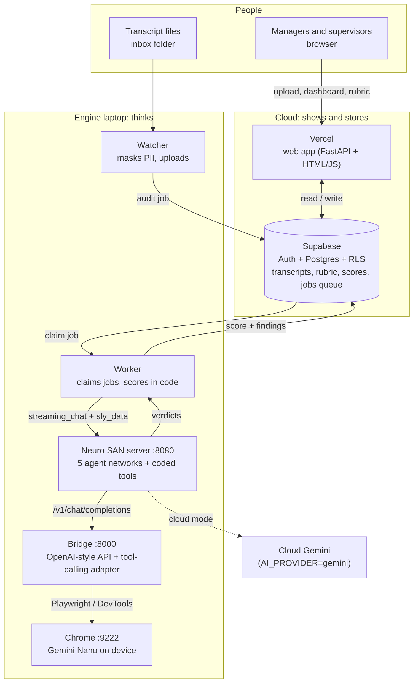

The cloud shows and stores, the laptop thinks, and the jobs queue connects them. The website never calls the engine.

## 2. One audit, end to end

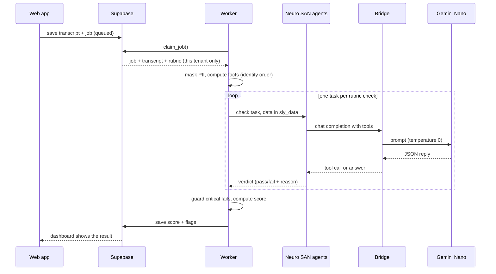

Notice that the model only ever sees one small task at a time, and everything before and after it is deterministic code.

## 3. The agent teams and who calls them

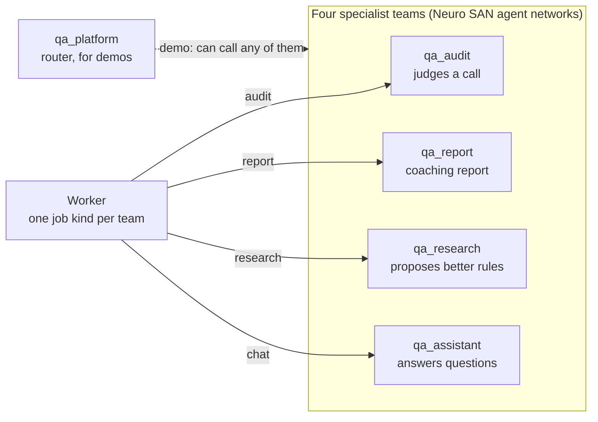

The worker dispatches by job kind. The teams do not call each other: only the demo router does.

## 4. How the teams are connected: through the data

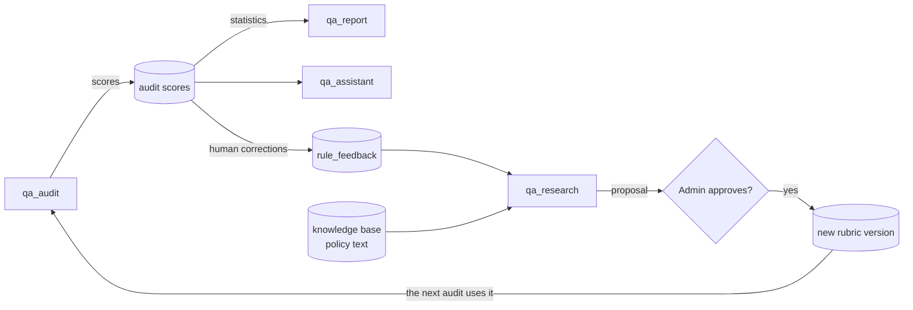

Audits feed reports and the assistant, corrections feed the researcher, and an approved rule change changes the next audit. A person approves the one step that changes behaviour.

## 5. Inside the audit team

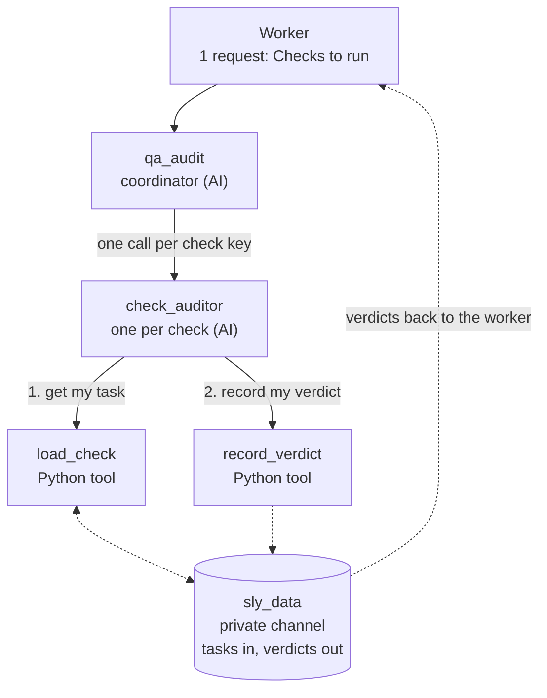

Two agents think, two tools act. The transcript never goes through a prompt: the models pass short keys, and the tools read the real data from sly_data.

## 6. Why a bridge, and how the model can change

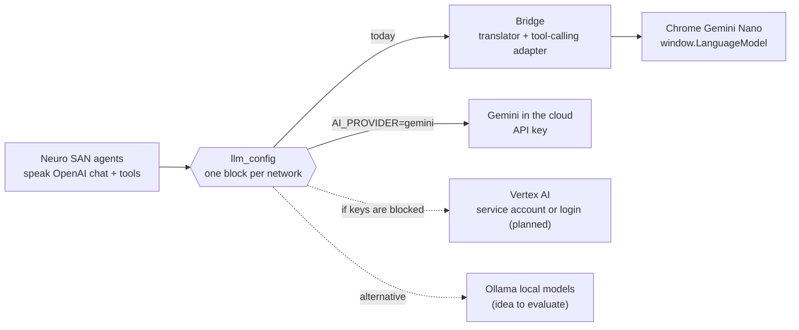

Because Neuro SAN reads the model from one block, we change where the thinking happens without touching the agents.

## 7. Tenant isolation

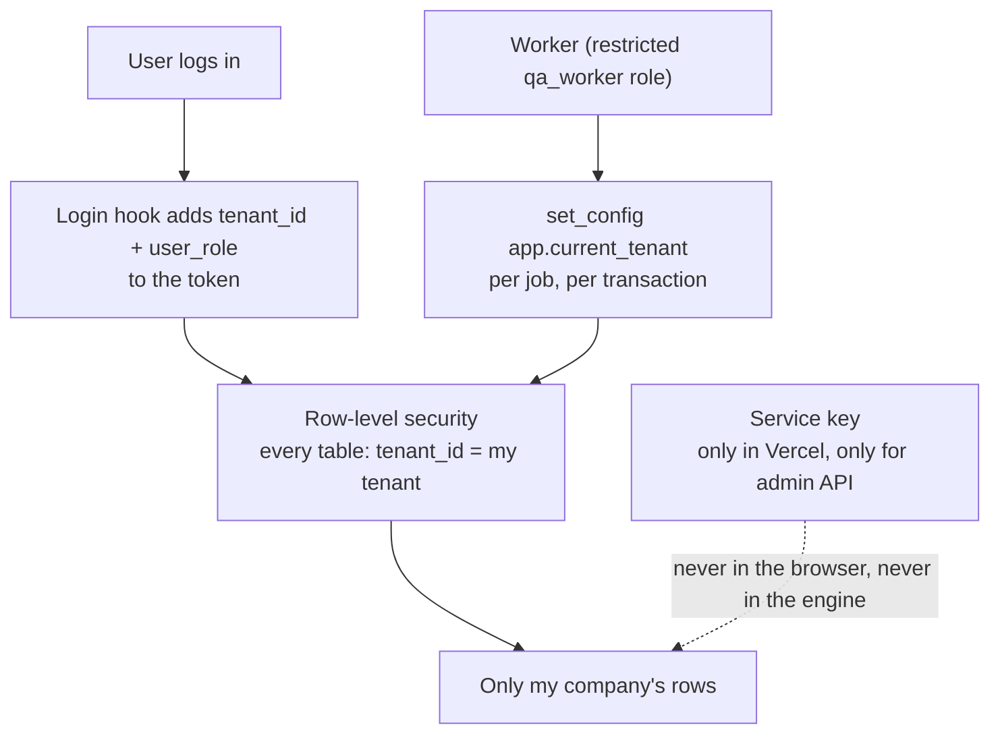

Isolation is enforced by the database, not by the website: even a bug in the page could not read another company's rows.

## 8. The learning loop

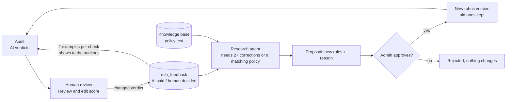

Two kinds of learning: immediate (corrected examples shown to the auditors) and governed (rule changes that a person approves).

## 9. Making a small model trustworthy

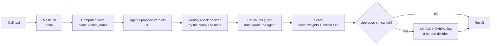

Rule of thumb we followed: the AI judges what needs judgment; code decides what can be counted.

## 10. Delivering it to the managers

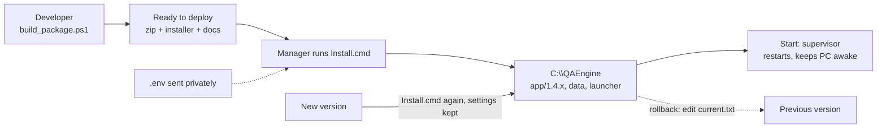

## 11. The main data tables

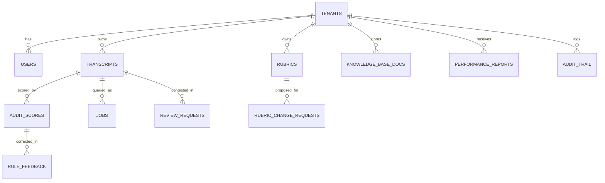

Every table carries the tenant, which is what makes the isolation rule one line of policy on each of them.

